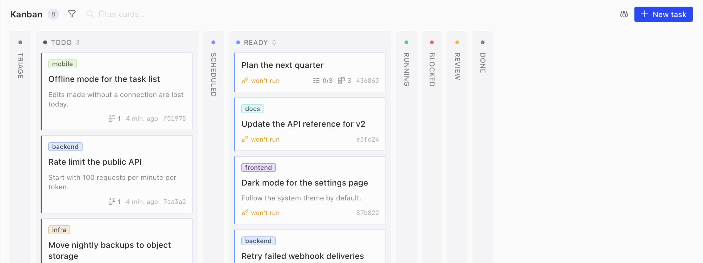
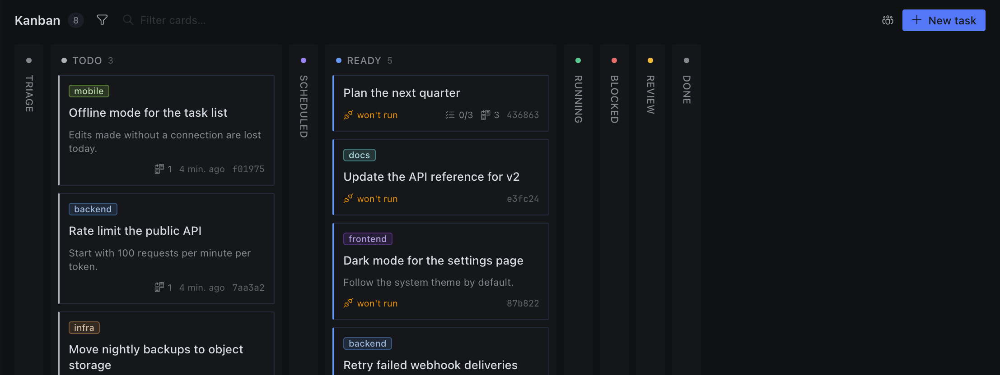
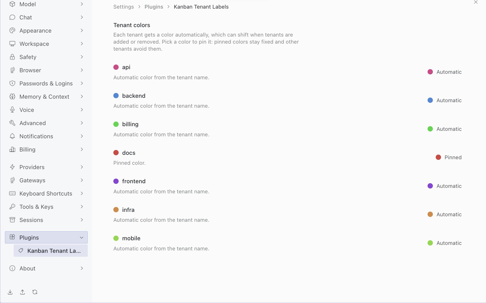

# Kanban Tenant Labels

Kanban Tenant Labels is a Hermes Desktop plugin that shows each Kanban card's
tenant as a small colored label on the card. Every tenant gets its own color,
and you can pin colors in the plugin's settings. Cards without a tenant get no
label, and card titles stay as they are.





## Requirements

- A Hermes release that includes the Kanban card badge slot of the Desktop
  plugin SDK (`KANBAN_CARD_AREAS.badges`, added in
  [NousResearch/hermes-agent#143673](https://github.com/NousResearch/hermes-agent/pull/143673)).
  Hermes v0.22.5 and earlier do not have it: the plugin then adds no labels and
  logs one `[hermes-kanban-tenant-labels]` console warning. On those versions use
  [v0.3.0](https://github.com/mszenfeld/hermes-kanban-tenant-labels/releases/tag/v0.3.0),
  for example
  `hermes plugins install mszenfeld/hermes-kanban-tenant-labels --ref 48f4f34da212c8322e50dbcbbd4dfd2936ca6d41 --no-enable`.
- The bundled Kanban plugin, enabled in Capabilities → Plugins → Kanban.
- Kanban cards with a tenant.

Tested on macOS with Hermes Desktop built from hermes-agent commit `e04614a`,
the merge of the card badge slot.

## Install

### From Hermes Desktop

This is the recommended way to install. Open Capabilities → Plugins → Install
from Git, enter `https://github.com/mszenfeld/hermes-kanban-tenant-labels`,
choose Review repository, then Install. The dialog marks the repository
Unverified because the plugin is not in the catalog.

Desktop installs only the `desktop/` folder, as a desktop plugin named
`hermes-kanban-tenant-labels`. The plugin is on right away and has no Agent
half to switch.

### From the command line

```bash
hermes plugins install mszenfeld/hermes-kanban-tenant-labels --no-enable
```

This installs the whole package into `~/.hermes/plugins/` without turning
anything on. In Desktop, open Capabilities → Plugins → Rescan, then switch
Desktop on for the package. Leave its Agent switch off and do not run
`hermes plugins enable` for it, because the package has no Agent code (see
[Known issues](#known-issues)).

If you enable it anyway and the CLI asks to install Node dependencies, answer N.
`package.json` only holds the test script and declares no dependencies.

### With an install link

```text
hermes://plugin/install?repo=mszenfeld/hermes-kanban-tenant-labels
```

Paste this into a browser's address bar. Desktop opens the same review dialog as
Install from Git and installs nothing until you confirm.

## Colors and pins

The palette has 12 hues in 30° steps, `hsl(0…330 68% 58%)`, matching the SDK's
`PROFILE_SWATCHES`. A hash of the tenant name picks each tenant's preferred hue.
If two tenants want the same hue, the one later in name order takes the next
free hue. The tenants that count are those in the board's tenant list, the one
its tenant filter offers, archived cards included.

With up to 12 tenants, each gets its own color unless pins reserve too many hues
or two tenants are pinned to the same hue. With more than 12, the extra tenants
share hues. Colors can shift when tenants are added or removed, or when you
switch boards, because a new tenant earlier in name order can take another
tenant's hue.

To keep a color fixed, open Settings → Plugins → Kanban Tenant Labels and pick a
color for the tenant. Choose Automatic color to unpin it. A pinned color stays
reserved even when its tenant is not on the board, and other tenants avoid
pinned colors unless all 12 hues are pinned.
The settings page lists the tenants of the last board that showed at least one
card since the plugin was last loaded (Desktop start, a plugin reload or
switching the plugin back on), plus pinned tenants. A board that shows no card,
for example when the filters match nothing, leaves that list as it was.

Desktop paints the label. The plugin only picks one of the SDK's twelve badge
hues, `KANBAN_CARD_BADGE_HUES`, which are the same colors as this palette.



## Permissions & privacy

The plugin reads what Desktop passes to its card badge decorator (each card's
tenant and the board's tenant list) and the pins it stored itself. No network
requests, no query-cache reads, no backend, Python or shell commands, no
telemetry.

It stores only pinned colors through `ctx.storage` under `pins`
(`hermes.plugin.hermes-kanban-tenant-labels.*`); writes no markup, because
Desktop paints the labels.

No timers, observers or listeners in the background; when a rendered card
brings a changed board tenant list, the plugin updates its settings page once
through a 0 ms `ctx.setTimeout`. On a Hermes without the slot it logs one
console warning and registers nothing.

## How it works

Desktop's Kanban board calls the plugin's badge decorator for each card through
`KANBAN_CARD_AREAS.badges`. The decorator returns the tenant as the label, a hue
and a `Tenant: <name>` tooltip. Desktop paints the label in a row above the card
title and adds the plugin's name to the tooltip. Picking a color in Settings
registers the decorator again with the new pins and the board repaints.
Switching the plugin off, reloading or removing it removes every label.
[docs/design.md](docs/design.md) has the details.

## Limitations

Labels need the slot (see [Requirements](#requirements)). Desktop decides how
labels look and where they sit. Labels longer than 24 characters are shortened
with an ellipsis, and the tooltip shows up to 160 characters.

Only the Hermes Desktop board shows labels, because the web dashboard's Kanban
board has no card slot.

## Known issues

- If the Agent half is enabled after a command-line install,
  `~/.hermes/logs/agent.log` shows
  `Failed to load plugin 'hermes-kanban-tenant-labels': No __init__.py in …` on
  every start. This is upstream bug
  [NousResearch/hermes-agent#132741](https://github.com/NousResearch/hermes-agent/issues/132741).
  The plugin works anyway. To silence the message, switch the Agent half off or
  run `hermes plugins disable hermes-kanban-tenant-labels`. The package has no
  Python code and does not ship an `__init__.py`. Installs from Hermes Desktop
  are not affected.

## Catalog status

This plugin is not in the Hermes plugin catalog yet. Its entry,
[NousResearch/hermes-agent#143060](https://github.com/NousResearch/hermes-agent/pull/143060),
is on hold until a Hermes release ships the Kanban card badge slot
([NousResearch/hermes-agent#143673](https://github.com/NousResearch/hermes-agent/pull/143673))
that this plugin now uses.

## Uninstall

Switching the plugin off in Capabilities → Plugins removes every label at once.

- Installed from Desktop: open Capabilities → Plugins and choose Uninstall on
  the plugin's row.
- Installed from the command line: run
  `hermes plugins remove hermes-kanban-tenant-labels`, then Rescan (or restart)
  so Desktop drops its copy.
- Copied by hand: delete
  `~/.hermes/desktop-plugins/hermes-kanban-tenant-labels` and run
  ⌘K → Reload desktop plugins.

## Development

Use Node 20.19 or later:

```bash
npm ci
node --test
```

To try a checkout in Desktop, link it into your plugins folder as a unified
package:

```bash
ln -s "$PWD" ~/.hermes/plugins/hermes-kanban-tenant-labels
```

Then open Capabilities → Plugins → Rescan and switch Desktop on for the package,
leaving Agent off. Every save re-syncs and reloads the Desktop copy.
Alternatively, copy `desktop/plugin.js` into
`~/.hermes/desktop-plugins/hermes-kanban-tenant-labels/plugin.js` and run
⌘K → Reload desktop plugins.

[AGENTS.md](AGENTS.md) has the rules for contributors and coding agents,
including the checks to run before a pull request.

## License

MIT. See [LICENSE](LICENSE).
